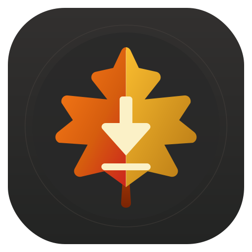
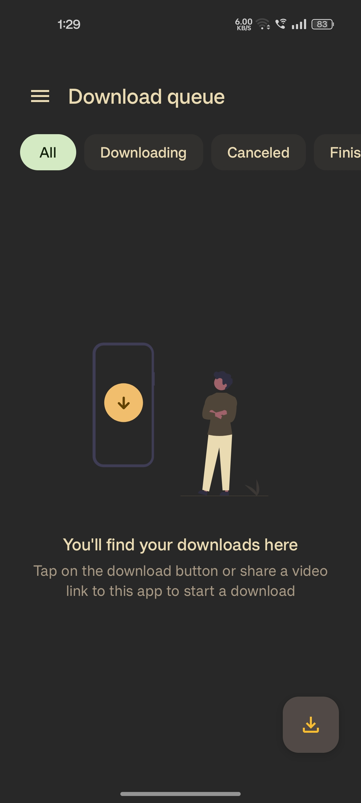
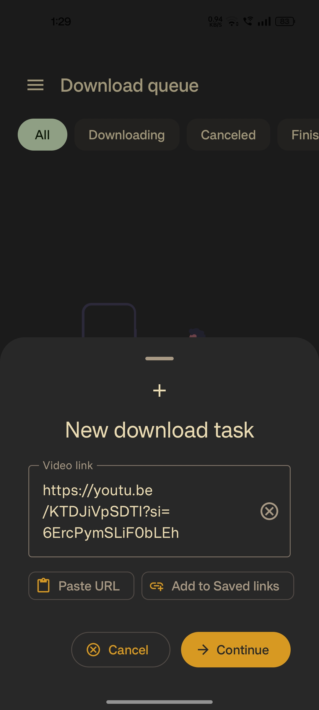
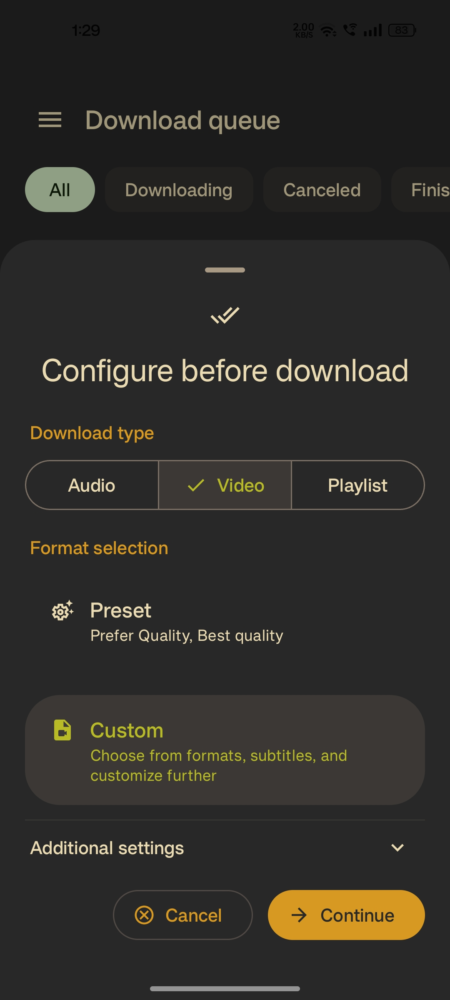
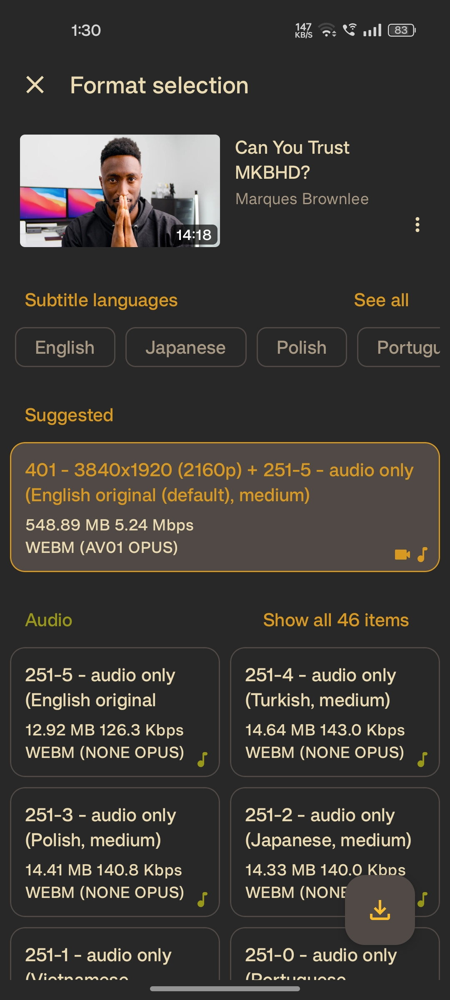
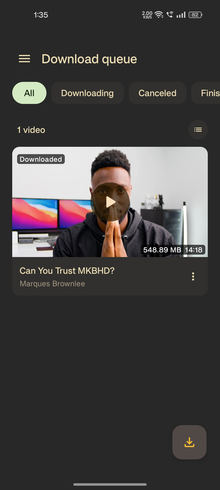
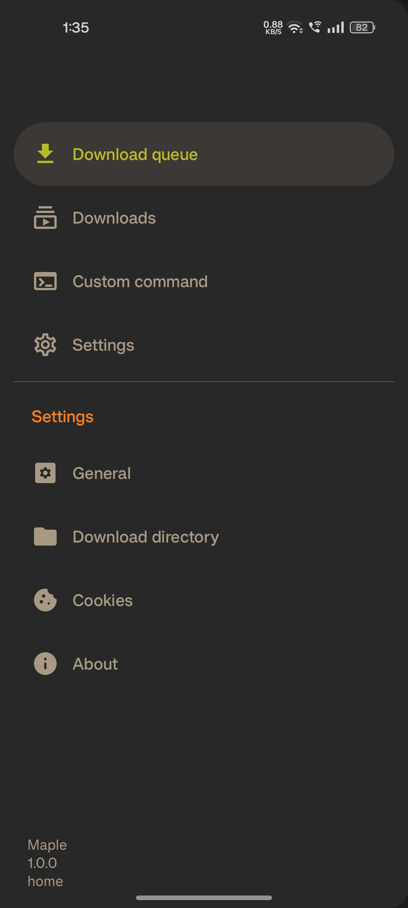

<div align="center">



# Maple

**A clean, modern video and audio downloader for Android**

[](https://github.com/ismeetxd/Maple/releases/latest)
[](LICENSE)
[](https://www.android.com/)
[](https://github.com/yt-dlp/yt-dlp/blob/master/supportedsites.md)

<br/>
<br/>




<br/>




</div>

---

## Overview

**Maple** is an open-source Android frontend for [yt-dlp](https://github.com/yt-dlp/yt-dlp), powered by [youtubedlp-android](https://github.com/ismeetxd/youtubedlp-android). It provides an intuitive, distraction-free Material Design 3 interface for downloading videos, extracting audio, and managing media across hundreds of supported sites.

## ✨ Features

- **Multi-Platform Support**: Download video and audio from 1,000+ sites supported by [yt-dlp](https://github.com/yt-dlp/yt-dlp).
- **Audio Extraction**: Save streams as high-quality audio formats (MP3, M4A, Opus, etc.) with metadata and thumbnails embedded via Mutagen.
- **Playlist Downloads**: Queue and batch download entire playlists with custom range selection.
- **Fast & Resilient**: Built-in multi-threaded concurrent downloading powered by [aria2c](https://github.com/aria2/aria2).
- **Subtitles & Chapters**: Automatically fetch and embed soft-subtitles into downloaded media.
- **Custom Command Templates**: Full terminal-grade flexibility to run tailored `yt-dlp` commands and arguments directly within the app.
- **Material You**: Beautiful Material Design 3 interface with dynamic color theme and system dark mode support.
- **Privacy First**: No tracking, completely open source, with built-in incognito/private download options.

## 📥 Download

Grab the latest APK from the [GitHub Releases](https://github.com/ismeetxd/Maple/releases/latest) page.

> **Tip:** For modern Android devices, download the **`arm64-v8a`** build for the best performance and smallest file size.

## 🛠️ Building from Source

Ensure you have Java 21 and the latest Android SDK installed:

```bash
# Clone the repository
git clone https://github.com/ismeetxd/Maple.git
cd Maple

# Build debug APK
./gradlew assembleDebug
```

## 🧱 Credits & Acknowledgments

Maple is built upon the work of several amazing open-source projects:

- [yt-dlp](https://github.com/yt-dlp/yt-dlp) — The powerful command-line media downloader
- [youtubedlp-android](https://github.com/ismeetxd/youtubedlp-android) — Android library port of yt-dlp
- [Read You](https://github.com/Ashinch/ReadYou) — UI design inspiration
- [aria2](https://github.com/aria2/aria2) — High-speed download utility
- [JitPack](https://jitpack.io/#IsmeetXD/youtubedlp-android) — Package repository for youtubedlp-android
- [MvnRepository](https://mvnrepository.com) — Open-source artifact search
- [Maven Central](https://central.sonatype.com/publishing/namespaces) — Sonatype Central Publisher
- [Maple](https://github.com/IsmeetXD/Maple) — Official repository
- [youtubedlp-android](https://github.com/IsmeetXD/youtubedlp-android) — Official library repository

## 📄 License

Maple is free and open-source software licensed under the [GNU General Public License v3.0 (GPL-3.0)](LICENSE).

- **Freedom to run:** Anyone may run the application for any purpose.
- **Freedom to study & modify:** Source code is fully open and customizable.
- **Freedom to redistribute:** You may redistribute copies and modifications under the terms of the GPL-3.0 license.
